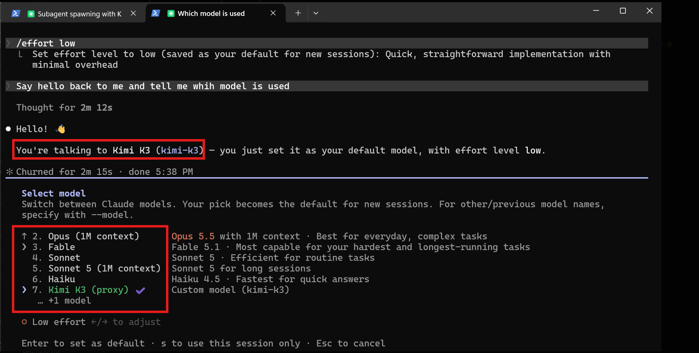

# claude-code-multi-model

**Run Claude Code on your Claude subscription, and run its subagents on any other model.**
Kimi K3, GLM, DeepSeek, Qwen, a local Ollama model, anything behind OpenRouter or LiteLLM.
The main session stays real Claude on the login you already have. A subagent whose
`model:` line names another model is served by your own upstream. No API-key swap, no
second terminal, no restart to change models.

[](https://github.com/DevinoSolutions/claude-code-multi-model/actions/workflows/ci.yml)
[](LICENSE)
[](pyproject.toml)

```
claude-multi                 # Claude Code, on your subscription, with a loopback gateway in front
> use the kimi subagent to add tests for app/auth.py
                              # main loop: Claude (Anthropic, your OAuth login)
                              # kimi-k3-worker: Kimi K3 (your upstream), spawned natively
> /model deepseek-chat        # switch the main loop itself, mid-session, no restart
```

## Why this exists

Claude Code talks to exactly **one** base URL, and its subagents inherit it. So you could
either have real Claude (Anthropic) or another provider (`ANTHROPIC_BASE_URL` plus a key),
not both in one session. Every "use model X in Claude Code" guide makes you give up the
subscription and pay per token for Claude too, or run two terminals.

`claude-code-multi-model` is a ~300-line gateway on `127.0.0.1` that answers that one base URL
and splits by model name:

```
                 ┌──────────────────────────────┐
  Claude Code ──►│ claude-code-multi-model  :8290     │
  (your login)   │                              │
                 │  model claude-*  ───────────►│──► api.anthropic.com   (your OAuth/API key, untouched)
                 │  any other model ───────────►│──► YOUR upstream       (your upstream key only)
                 └──────────────────────────────┘
```

It works because of a documented Claude Code rule: **setting `ANTHROPIC_BASE_URL` without a
credential variable keeps your saved claude.ai login as the active credential** (see the
[LLM gateway guide](https://code.claude.com/docs/en/llm-gateway), "Subscriptions and
gateways"). The gateway forwards that credential to Anthropic and to nobody else.

## Proof

A real Claude Code session started with `claude-multi`, no `ANTHROPIC_API_KEY` set. The
`/model` picker lists Kimi K3 next to Opus, Sonnet and Haiku, and the turn before it was
answered by Kimi K3 through the gateway's upstream. The Claude entries still run on the
subscription login.



## 60-second start

Prerequisites: Claude Code installed and logged in (`claude` on your PATH), Python 3.11+,
and one upstream that speaks the **Anthropic Messages API** for the other models.

```bash
pip install git+https://github.com/DevinoSolutions/claude-code-multi-model   # or: uv tool install git+https://github.com/DevinoSolutions/claude-code-multi-model
claude-multi init        # asks for the upstream URL, key and picker models; writes a 0600 config file
claude-multi models      # what the upstream serves, to choose MULTI_MODEL_MODELS from
claude-multi             # starts the gateway if needed, then Claude Code pointed at it
```

Then drop an agent definition into `.claude/agents/` (examples in [`agents/`](agents/)):

```markdown
---
name: kimi-k3-worker
description: Coding worker on Kimi K3. Use when the user says "use kimi".
tools: Read, Edit, Write, Glob, Grep, Bash
model: kimi-k3
---
You are a coding worker. Do the task and return the diff.
```

Say "use the kimi subagent to ..." and Claude Code spawns it natively: same Agent tool, same
tool permissions, same transcript, different model. Anything after `claude-multi` goes to
`claude` untouched (`claude-multi --continue`, `claude-multi -p "..."`).

## Upstreams that work

Any endpoint that accepts `POST <base>/v1/messages` in Anthropic's format. Set
`MULTI_MODEL_UPSTREAM_URL` to the base that makes that path correct:

| upstream | `MULTI_MODEL_UPSTREAM_URL` | notes |
|---|---|---|
| OpenRouter | `https://openrouter.ai/api` | hundreds of models, one key |
| Moonshot (Kimi) | `https://api.moonshot.ai/anthropic` | Kimi's own Anthropic-compatible endpoint |
| DeepSeek | `https://api.deepseek.com/anthropic` | `deepseek-chat`, `deepseek-reasoner` |
| Zhipu (GLM) | `https://open.bigmodel.cn/api/anthropic` | GLM 4.5 / 4.6 / 5.x |
| Ollama | `http://localhost:11434` | local models, key can be any non-empty string |
| LiteLLM proxy | `http://localhost:4000` | fan out to anything LiteLLM supports |
| your own proxy | whatever it is | this project was extracted from one |

Provider paths and model ids move; check the provider's "use with Claude Code" page for the
current base URL. The key is sent as both `Authorization: Bearer` and `x-api-key`, since
providers differ on which one they read.

## What you get

- **Native subagents on other models.** `model:` in the agent frontmatter is the only switch.
  Claude Code spawns them, tracks them, and shows them exactly as it does Claude subagents.
- **As many models in the `/model` picker as you want.** `MULTI_MODEL_MODELS="kimi-k3=Kimi K3,
  deepseek-chat=DeepSeek V4, glm-5.3=GLM 5.3, ..."` lists every one of them under Opus,
  Sonnet and Haiku, with your labels. `claude-multi models` prints what the upstream serves
  so you can pick. The rows go to `claude` as `--settings` (Claude Code's `modelPicker`);
  your own settings.json is never touched.
- **`/model <id>` mid-session.** The main loop can move to any listed model and back without
  restarting. A listed model is switched to without Claude Code's ~15-second availability
  probe, which a slow first token (Kimi K3, about 100 s) would fail.
- **The main loop knows where it is.** The launcher appends a `SESSION MODE:
  claude-code-multi-model` line to the system prompt, so Claude spawns the native `model:` agent
  for "use Kimi" instead of relaying through a shell. Pass your own `--append-system-prompt`
  and it stays out of the way.
- **The subscription stays in charge.** No `ANTHROPIC_API_KEY`, no per-token Claude bill.
- **One command.** `claude-multi` starts the gateway if it is not running and then `claude`.
  `claude-multi status` and `claude-multi stop` for the gateway itself.
- **A log that shows the split.** `class=main line=anthropic ...` versus
  `class=subagent line=upstream model=kimi-k3 ...`, with first-byte and total time per turn.

## Fifty sessions, one gateway

The gateway runs **once per machine**, not once per session. Every `claude-multi` launch
checks `127.0.0.1:8290/health` first and only starts a gateway if nothing answers; a
gateway that starts and finds another one already up exits on its own. So fifty Claude Code
sessions, each spawning subagents, share one process: a single asyncio server with an
unbounded outbound pool, where each session and each subagent is just one more streamed
request in flight. No worker pool, no per-session state, nothing to replicate. The test
suite streams 64 concurrent upstream turns through one gateway and checks they overlap
instead of queueing.

`claude-multi stop` stops that one shared process; every session pointed at it fails its
next request until something starts it again, so stop it when the last session is done.

## What leaves your machine, exactly

| request | goes to | with |
|---|---|---|
| `model: claude-*` carrying your own credential | `api.anthropic.com` | same bytes, same headers minus hop-by-hop and edge headers. `anthropic-beta` is kept because OAuth needs it. |
| everything else (`kimi-k3`, `/v1/models`, OpenAI-dialect paths) | `MULTI_MODEL_UPSTREAM_URL` | headers rebuilt from nothing (`content-type`, `anthropic-version`, `anthropic-beta`, `accept`) plus your upstream key. No `x-claude-code-*`, no cookie, **never your Claude credential**, and the body's `metadata` (your claude.ai account and device ids) removed. |

The gateway binds loopback only and has no option to do otherwise. Nothing logs a header
value or a body. See [SECURITY.md](SECURITY.md); every line of that table is a test.

## Configuration

Environment variables win over the config file (`claude-multi init` writes it;
`claude-multi status` prints its path).

| variable | meaning | default |
|---|---|---|
| `MULTI_MODEL_UPSTREAM_URL` | base URL serving every non-Claude model | required |
| `MULTI_MODEL_UPSTREAM_KEY` | its key | required |
| `MULTI_MODEL_PORT` | gateway port | `8290` |
| `MULTI_MODEL_MODELS` | upstream models for the `/model` picker, comma-separated, optional `=Label` each (`kimi-k3=Kimi K3,glm-5.3`) | unset |
| `MULTI_MODEL_CUSTOM_MODEL` | one more picker row (older single-slot form) | unset |
| `MULTI_MODEL_CUSTOM_MODEL_NAME` | its label in the picker | `<id> (multi-model)` |
| `MULTI_MODEL_ANTHROPIC_URL` | where `claude-*` goes | `https://api.anthropic.com` |

Run the gateway by itself (a service, a container, a different launcher):

```bash
MULTI_MODEL_UPSTREAM_URL=https://openrouter.ai/api MULTI_MODEL_UPSTREAM_KEY=sk-or-... python -m claude_code_multi_model.gateway
# then, in another shell, with NO ANTHROPIC_API_KEY set:
ANTHROPIC_BASE_URL=http://127.0.0.1:8290 CLAUDE_CODE_GATEWAY_HINT_HEADERS=1 claude
```

## FAQ

**Does this bypass anything?** No. It uses the documented `ANTHROPIC_BASE_URL` gateway
mechanism, your own Anthropic login goes only to Anthropic, and your own upstream key goes
only to your upstream. It is the same split as running two clients, in one process.

**Does the main session have to be Claude?** No. `/model kimi-k3` moves the main loop to the
upstream; `/model opus` brings it back. Every id in `MULTI_MODEL_MODELS` is a row in the picker. A subagent with `model: opus` in a multi-model session is
real Claude Opus on your subscription.

**Can I route by agent name instead of model?** Claude Code does not send the agent name,
only the model id (and `x-claude-code-agent-id`, which the gateway logs but never routes on).
So the name is a convention: `kimi-k3-worker` with `model: kimi-k3`.

**Why not [claude-code-router](https://github.com/musistudio/claude-code-router)?** It is a
great general router, but it replaces the credential, so the Claude turns bill an API key.
This project keeps the subscription for Claude and only moves the rest. The closest prior art
is [subagent-handoff](https://github.com/1morr/subagent-handoff) (Node), which does the same
split; this one is Python, ships a launcher and a test suite, and came out of running fifty
Kimi K3 subagents at once behind it.

**Windows?** Yes. The launcher, gateway and tests run on Windows, macOS and Linux (CI matrix).

**Does it slow Claude down?** One loopback hop and a streamed relay; first-byte overhead is
milliseconds. Long thinking turns are not timed out by the gateway (only the connect is).

## For AI coding agents

If you are an agent asked to set this up for a user, do exactly this:

1. `pip install git+https://github.com/DevinoSolutions/claude-code-multi-model` (or `uv tool install` the same URL).
2. Ask the user once for their upstream base URL and key; run `claude-multi init --upstream-url <url> --upstream-key <key> --models "<id>=<Label>,<id>=<Label>"` with the models they want in the `/model` picker (`claude-multi models` lists what the upstream serves).
3. Copy the agent files the user wants from `agents/` into the project's `.claude/agents/`, editing `model:` to an id the upstream serves.
4. Tell the user to start sessions with `claude-multi` instead of `claude`, and to say "use the <name> subagent" to spawn one.
5. Verify: `claude-multi status` shows the gateway up; a one-line `claude-multi -p "say hi"` returns; the gateway log (`claude-multi status` prints its path) shows `line=anthropic` for that turn.

Machine-readable summary: [`llms.txt`](llms.txt).

## Development

```bash
pip install -e ".[test]"
pytest -q
```

MIT. Extracted from a production proxy at [Devino](https://devino.ca) where it runs Claude Code
main loops on a subscription with dozens of concurrent Kimi K3 / GLM subagents.

<sub>Keywords, for the search engines and the agents that read them: Claude Code multi-model,
Claude Code subagent different model, run Claude Code subagents on Kimi K3 / DeepSeek / GLM /
Qwen / Ollama, Claude Code ANTHROPIC_BASE_URL keep subscription, Claude Code LLM gateway,
Claude Code OpenRouter subagents, mix models in Claude Code, multi-model Claude Code session.</sub>
